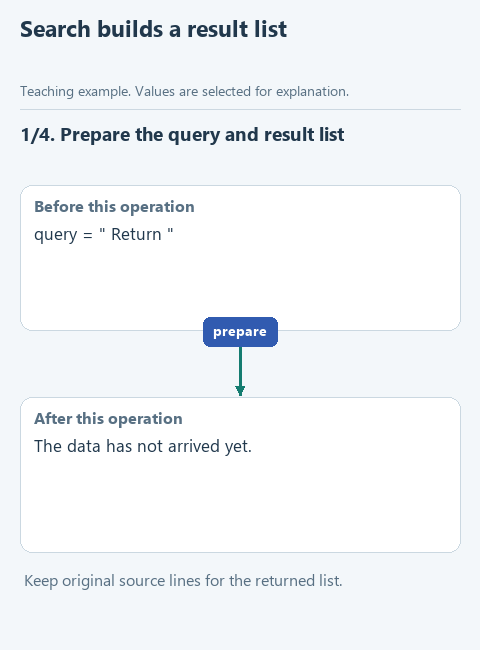

# Find policy clauses by keyword

> **Where we are.** We are building an assistant that answers from a returns policy. The first step is for the program to find the right clauses itself, with no model yet.
> `policy -> [search] -> model -> answer`

Recall the MTS case from the introduction: the assistant gave wrong advice because the right clause never reached the model. The first thing to check in such an investigation is whether the program found that clause at all. So we start by writing the function that finds clauses by keyword and watching exactly which lines it picks.

## The task

The policy has three clauses:

```text
Returns are accepted within 14 days.
Delivery within the city takes 1 day.
RETURNED money goes back to the original card.
```

A customer asks about returns. We want the clauses that mention "return", whether it is written in capitals or not.

**Guess before running:** how many clauses should the function return, and which ones? Keep your answer in mind; we will check it at the end.

## Open the starter

Download [this lesson's starter](../../downloads/lesson-01-01-search.zip), extract it with **Extract All** and open the `lesson-01-01-search` folder in PyCharm with **File -> Open**. In the Project panel (**View -> Tool Windows -> Project**) open `notes.py`. The function `find_notes` is already started there; we will complete it.

In the code the policy clauses live in a variable called `notes`. The name fits any short text records, which is why the functions are called `find_notes` and `read_notes`.

## Step 1. Normalize the query

A person may type the query with extra spaces or in capitals: `' Return '`. To compare reliably, strip the spaces and lower the case:

```python
query = ' Return '
query = query.strip().casefold()
print(query)   # return
```

`strip()` removes spaces at both ends, and `casefold()` turns letters into lower case for comparison: `'RETURNED'.casefold()` gives `'returned'`. Both return a new string, so we store the result back in `query`. This line is already at the start of `find_notes`.

## Step 2. Check one clause

Take the third clause and ask Python whether it contains the query:

```python
note = 'RETURNED money goes back to the original card.'
'return' in note.casefold()   # True
```

The `in` operator answers whether the string on the left occurs inside the string on the right. `'return'` occurs inside `'returned'`, so the check is true. The clause itself stays unchanged: `casefold()` makes a lowered copy only for the comparison, and the original clause, capitals and all, goes into the result.

## Step 3. Go through all clauses

Now check each clause in turn and collect the matching ones in a new list, `selected`. A `for` loop takes the clauses from `notes` one by one and runs the indented code under it for each:

```python
selected = []
for note in notes:
    if query in note.casefold():
        selected.append(note)
```

The spaces at the start of the lines matter. They tell Python that the `if` runs inside the loop and that `append` runs only when the condition is true. Use four spaces per level and keep the indentation as shown. `append` adds a clause to the end of `selected`.

The animation shows `selected` growing as the loop goes:



[Static version](../../assets/01-note-search/search-notes.png).

## Your turn

In `notes.py`, `find_notes` already prepares the query and creates the empty list `selected`. Replace the line `raise NotImplementedError(...)` with the loop and fill in the two gaps:

```python
    for note in notes:
        if ...:
            selected.append(...)
    return selected
```

1. In the condition, use the check from step 2 with the variable `query` instead of `'return'`.
2. In `append`, pass the original `note`: the customer needs the clause as it is written in the policy, not a lowered copy.

`return selected` sits after the loop, at the same level as `for`, and hands the collected list back to whoever called the function. If you indent it into the loop, the function will stop after the first clause.

## Run it

Open `demo_search.py` (it sits next to `notes.py`), right-click in the editor and choose **Run 'demo_search'**. In the Run window, under `find_notes`, you should see:

```text
['Returns are accepted within 14 days.', 'RETURNED money goes back to the original card.']
```

Did that match your guess? The delivery clause was skipped, and "RETURNED" in capitals was found thanks to `casefold()`. Under `find_notes_alt` you will see "Complete find_notes_alt using the lesson hints" for now: that is the optional task in the note at the end of the lesson.

If you see "Complete find_notes ..." under `find_notes` instead of a list, the file is not saved or the `raise NotImplementedError(...)` line is still in place. A diagram of the PyCharm windows is in [find a file and run an example](../pycharm.md).

## Try to break it

1. Remove `.casefold()` from the condition and run again. Which clause disappears, and why?
2. In `demo_search.py`, change the query to three spaces `'   '`. The function stops with "Enter a nonempty query". That check is there on purpose: an empty string is contained in every string, so without it the search would return the whole policy. While a person types the query, that seems unlikely; once a model or another part of the program calls the search, an empty value can arrive by mistake, and it is better to see it at once than to get the whole policy dressed up as a search result.

Put the code back the way it was before moving on.

## What we have now

We can check the first link in the MTS chain: did the program find the right clause? If a clause is in the policy but not in this list, the problem is in the search, and the model has nothing to do with it. In section 3 the model will ask for this same search, and your function will choose the lines.

This kind of selection is called **retrieval** in articles about AI. Ours is the simplest form: substring search. How retrieval relates to RAG is in the [list of terms](../terms.md).

To check the search on more cases (duplicates, no matches, unusual letters), see [let tests repeat the checks](extra-tests.md). Next: [read the policy from a file](02-read.md). Back to [all lessons](../README.md).

<details>
<summary>Optional: what `list[str]` and `-&gt;` mean in the function header</summary>

`def find_notes(notes: list[str], query: str) -> list[str]:` reads as: the function takes a list of strings and one string and returns a list of strings. These are hints for people and the editor; Python itself does not check them. You do not have to write them in your own functions yet.

</details>

<details>
<summary>Optional: the same search in one line</summary>

Python has a short form that builds a list directly: `[note for note in notes if query in note.casefold()]`. It does the same as the loop in step 3: goes through `notes` and keeps the clauses that contain the query. This form is called a list comprehension. To try it, open `find_notes_alt` in `notes.py`, replace its `raise NotImplementedError(...)` with `return [note for note in notes if query in note.casefold()]` and run `demo_search.py`: the same list appears under `find_notes_alt`.

</details>
