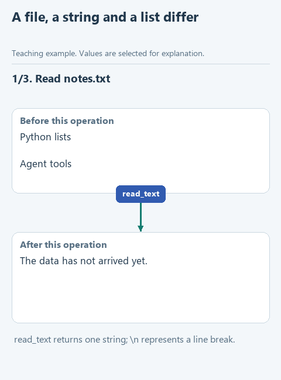

# Read the policy from a file

> **Where we are.** The assistant can search the policy by keyword, but we typed the clauses straight into the code. Now we take them from a file.
> `policy file -> [reading] -> search -> model -> answer`

In real systems the policy lives outside the program: in a file, a knowledge base, Confluence. Before searching, the assistant has to read it, and this step can fail too.

Suppose the assistant replies to a customer: "No information about returns found." That can mean two quite different things. The policy was read but has no clause about returns - then the document's owner has to add one. Or the file was never opened: it was moved to another folder, renamed, or the program lacks access - then it is a job for the administrator. If the program reports both cases with the same message, the question goes to the wrong person. So we write reading in a way that keeps the two cases apart.

## What is in the file

Download [this lesson's starter](../../downloads/lesson-01-02-read.zip), extract it and open the `lesson-01-02-read` folder in PyCharm with **File -> Open**. In the Project panel expand **data** and open `notes.txt`:

```text
Returns are accepted within 14 days.
  Delivery within the city takes 1 day.

RETURNED money goes back to the original card.
A receipt or order number is required for a return.
Exchanges are arranged at the pickup point.
Complaints are reviewed within 10 business days.
```

The second clause starts with stray spaces, and a blank line follows it - after a few edits a file often looks like this. The search, though, needs a tidy list with one clause per element:

```python
['Returns are accepted within 14 days.',
 'Delivery within the city takes 1 day.',
 'RETURNED money goes back to the original card.',
 'A receipt or order number is required for a return.',
 'Exchanges are arranged at the pickup point.',
 'Complaints are reviewed within 10 business days.']
```

This is the kind of list `find_notes` received in the previous lesson. Our job is to build it from the file.

**Guess before running:** how many elements will the list have if we simply cut the file into lines and do nothing else?

## Step 1. Read the whole file

In Python a file path is conveniently held in a `Path` object, and its `read_text` method reads the contents:

```python
path = Path('data/notes.txt')
text = path.read_text(encoding='utf-8')
```

The first line only says where the file is; the text appears after `read_text` is called. `encoding='utf-8'` sets the encoding: without it, Windows may read some characters incorrectly. In our function you do not create the path yourself: `demo_read.py` passes it in as an argument.

`text` now holds one long string with the whole policy; the line breaks of the file are marked in it by `\n`.

## Step 2. Cut the text into lines

`splitlines()` splits the text at line breaks and returns a list. Here are the first lines of the file:

```python
lines = text.splitlines()
# ['Returns are accepted within 14 days.',
#  '  Delivery within the city takes 1 day.',
#  '',
#  'RETURNED money goes back to the original card.',
#  ...]
```

That answers the question above: seven elements, not six. The blank line between clauses became an empty element `''`, and the spaces before "Delivery" are still there. Give this list to the search and it will loop over the empty element, while the spaces end up in the model's answer.



[Static version](../../assets/01-note-search/read-data.png).

## Step 3. Clean each line

We remove spaces at the edges with the familiar `strip()` and keep only the lines that still have something left. We go through the lines with a loop, as in the previous lesson:

```python
cleaned_notes = []
for line in lines:
    cleaned_line = line.strip()
    if cleaned_line:
        cleaned_notes.append(cleaned_line)
```

The condition `if cleaned_line` is true only for a nonempty string: Python treats an empty one as false. `strip()` does not touch spaces between words, only those at the edges.

## Your turn

Open `notes.py` and find `read_notes`. Reading the file and splitting it into lines are already written, and the list `cleaned_notes` is created. Replace the line `raise NotImplementedError(...)` with the loop and fill in the gaps:

```python
    for line in lines:
        cleaned_line = ...
        if ...:
            cleaned_notes.append(...)
    return cleaned_notes
```

1. Store the cleaned line in `cleaned_line`: `line.strip()`.
2. In the condition, put what makes the line worth keeping: `cleaned_line` itself.
3. Pass `cleaned_line` to `append`, not the original `line` with its spaces.

`return cleaned_notes` comes after the loop and hands the finished list to the caller. If the file has no text at all, the loop never runs and the function returns an empty list.

## Run it

Open `demo_read.py`, right-click in the editor and choose **Run 'demo_read'**. The Run window should show a list of six clauses, with no blank line and no spaces before "Delivery".

## Try to break it

1. **An empty policy.** Delete the contents of `data/notes.txt` and save the file. After running `demo_read.py` the function returns an empty list `[]`: the file was read and has no clauses.
2. **No file.** Put the text back and rename the file, for example to `notes_old.txt`. Now the program stops with `FileNotFoundError`, and the message names the file it could not find.

Back to the example from the start of the lesson. An empty list means the policy itself needs a new clause. `FileNotFoundError` means the program never got to the document. That is why we do not catch the error and turn it into an empty list: otherwise the assistant would answer "no information found", and nobody would know it never opened the document.

Rename the file back before the next lesson.

## What we have now

The assistant takes the policy from a file, and the result of reading shows where to look for a problem: in the content of the document or in access to it. In real systems documents usually sit in a knowledge base or Confluence, but the questions are the same: was the source read, and what was in it.

Next: [save the search result](03-journal.md), so that after a run you can see exactly what the assistant found. Back to [all lessons](../README.md).
