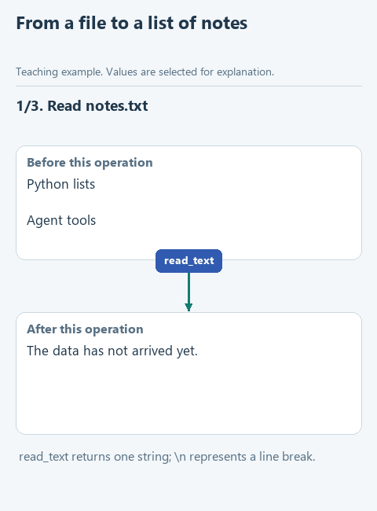

# Read notes from a file

> **Where we are.** The assistant can search notes, but we typed the notes straight into the code. Now we take them from a file.
> `notes file -> [reading] -> search -> model -> answer`

In real systems the knowledge lives outside the program: in a file, a knowledge base, a wiki. Before searching, the assistant has to read it, and this step can fail too.

Suppose the assistant replies "No information found." That can mean two quite different things. The file was read and simply contains nothing relevant - then whoever owns the document has to add it. Or the file was never opened: it was moved, renamed or the program lacks access - then it is a job for the administrator. If the program reports both cases with the same message, the question goes to the wrong person. So we write reading in a way that keeps the two cases apart.

## Open the starter

Download [this lesson's starter](../../downloads/lesson-01-02-read.zip), extract it and open the `lesson-01-02-read` folder in PyCharm. The current task is `read_notes` in `notes.py`; the search from the previous lesson already works.

## Look at the data

The file `data/notes.txt` holds one note per line. A file edited by hand often has stray spaces and blank lines, for example:

```text
Python lists

  Agent tools
```

After `path.read_text(encoding='utf-8')` this becomes one string: `'Python lists\n\n  Agent tools\n'`, where `\n` marks a line break. `splitlines()` cuts it into a list: `['Python lists', '', '  Agent tools']`.

**Guess before reading on:** what is wrong with that list if we hand it to the search?

There is an empty element, and spaces are still stuck to "Agent tools". The search needs clean notes: `['Python lists', 'Agent tools']`.



[Static version](../../assets/01-note-search/read-notes.png).

## Your turn

In `read_notes`, reading the file and splitting it into lines are already done, and the empty list `cleaned_notes` is created. Replace `raise NotImplementedError(...)` with the loop and fill in the gaps:

```python
def read_notes(path: Path) -> list[str]:
    text = path.read_text(encoding='utf-8')
    lines = text.splitlines()
    cleaned_notes = []
    for line in lines:
        cleaned_line = ...
        if ...:
            cleaned_notes.append(...)
    return cleaned_notes
```

1. `cleaned_line` gets `line.strip()`, the line without spaces at the ends.
2. The condition is `cleaned_line` itself: an empty string counts as false in Python, so empty lines are skipped.
3. `append` receives `cleaned_line`, not the original `line` with its spaces.

`encoding='utf-8'` tells Python how the bytes of the file turn into characters. If the file is empty, the loop never runs and the function returns an empty list.

## Run it

Open `demo_read.py`, right-click in the editor and choose **Run 'demo_read'**. The Run window shows the list of notes from `data/notes.txt`, each without stray spaces. Compare it with the file itself.

## Try to break it

1. **Empty file.** Delete everything in `data/notes.txt` and save. `demo_read.py` prints `[]`: the file was read and has no notes.
2. **Missing file.** Restore the text and rename the file, for example to `notes_old.txt`. Now the program stops with `FileNotFoundError` and the name of the file it could not find.

Compare the two. An empty list says the document itself needs content. `FileNotFoundError` says the program never reached the document. That is why we do not catch the error and turn it into an empty list: the assistant would then say "no information found", and nobody would learn it never opened the document.

Rename the file back before the next lesson.

## What we have now

The assistant reads its notes from a file, and the result tells you where to look when something goes wrong: in the content of the document or in access to it. Next: [save a search result](03-journal.md), so that after a run you can see exactly what the search found. Back to [all lessons](../README.md).
