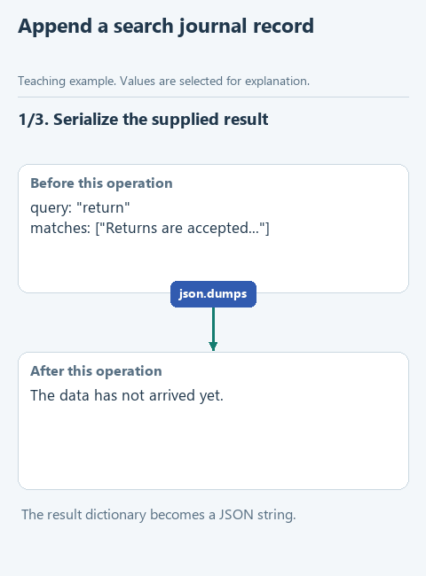

# Save a search result

> **Where we are.** The assistant reads notes from a file and finds lines by keyword. So far the result exists only in the Run window. Now the program will write it to a journal.
> `file -> reading -> search -> [journal]`

Imagine a user got a wrong answer yesterday and today you are working out why. The Run window is long closed, and there is no way to see what the search found then. Was the right note among the results? Which query did the search actually receive? Without a record you cannot answer, and these are exactly the questions the MTS case starts with.

So we will write every search result to a file: the query and the matching notes. Each new record goes at the end, so earlier ones stay available for comparison.

## Open the starter

Download [this lesson's starter](../../downloads/lesson-01-03-journal.zip), extract it and open the `lesson-01-03-journal` folder in PyCharm. Reading and searching already work. The current task is `write_result` in `journal.py`.

## Look at the data

Suppose a search for "python" found one note. The result is kept in a dictionary: `query` holds the query and `matches` the list of found notes. To write a dictionary to a text file, we turn it into a JSON string:

```python
result = {'query': 'python', 'matches': ['Python lists']}
text = json.dumps(result, ensure_ascii=False)
# '{"query": "python", "matches": ["Python lists"]}'
```

`json.dumps` turns the dictionary into one line of text; `ensure_ascii=False` keeps any non-English letters readable. Each record takes its own line in the file. This format is called JSONL, JSON Lines.



[Static version](../../assets/01-note-search/lesson-03-journal.png).

## Your turn

In `write_result`, the string `text` is ready. Open the journal file and add it at the end. Replace `raise NotImplementedError(...)` with two lines and fill in the gap:

```python
def write_result(path: Path, result: dict) -> None:
    text = json.dumps(result, ensure_ascii=False)
    with path.open('a', encoding='utf-8') as stream:
        stream.write(...)
```

Pass `text + '\n'`: the JSON itself and a line break after it. Without `'\n'` the next record would stick to the previous one.

The `'a'` in `path.open` means append mode: new lines go to the end of the file, and the file is created if it does not exist yet. Inside the `with` block, `stream` is the open file, and Python closes it when the block ends. The function returns nothing; its result is a changed file.

## Run it

Open `demo.py`, right-click in the editor and choose **Run 'demo'**. The Run window shows the last line of the journal:

```text
{"query": "python", "matches": ["Python lists"]}
```

A file `runs.jsonl` appears next to `demo.py`. Open it: it contains the same line.

## Try to break it

1. Run `demo.py` twice more and open `runs.jsonl`. There are now three records, each on its own line.
2. Change `'a'` to `'w'` in `write_result` and run again. Only one record is left: mode `'w'` (write) empties the file every time. For a journal that would mean losing the whole history. Change it back to `'a'`.

## What we have now

Every run leaves a trace: which query the search received and what it found. Once a model uses the search, this journal shows which notes it really got. To check the function further, open `tests/test_lesson.py`, right-click `class LessonTests` and choose **Run**.

Next: [connect reading, search and the journal](04-run.md) into one operation. Back to [all lessons](../README.md).
