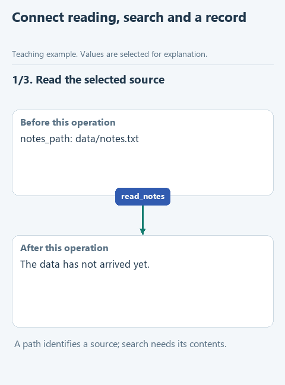

# Connect reading, search and the journal

> **Where we are.** The assistant has three separate functions: reading the policy, searching and writing to the journal. We combine them into one operation that an agent will be able to call later.
> `[file -> reading -> search -> journal]` -> result

To find the return clauses now, you have to call three functions in turn and keep them in the right order. In section 3 the agent will need a single "search" command, after which the program does the rest by itself. While we are at it, we add a status to the result: `found` if clauses were found and `not_found` if not. The status shows the outcome at a glance, without studying the list.

## Open the starter

Download [this lesson's starter](../../downloads/lesson-01-04-run.zip), extract it and open the `lesson-01-04-run` folder in PyCharm. The current task is `run_search` in `app.py`.

## Look at the data

`demo.py` already holds the path to the policy `data/notes.txt`, the query `' return '` and the path to the journal `runs.jsonl`. `run_search` receives these three values and returns a dictionary with the query, the status and the found clauses.

The status takes one line:

```python
status = 'found' if matches else 'not_found'
```

If `matches` is not empty, the result is `'found'`; for an empty list `[]` it is `'not_found'`.

**Guess before running:** how many of the six clauses will the query "return" find? Hint: read the fourth and fifth clauses carefully.



[Static version](../../assets/01-note-search/lesson-04-run.png).

## Your turn

In `run_search`, the policy is already read and searched: the result is in `matches`. Replace `raise NotImplementedError(...)` with the code below and fill in the gaps:

```python
    status = 'found' if matches else 'not_found'
    result = {
        'query': ...,
        'status': ...,
        'matches': ...,
    }
    write_result(..., ...)
    return result
```

1. In `'query'`, put the query without edge spaces: `query.strip()`.
2. In `'status'` and `'matches'`, the variables `status` and `matches`.
3. `write_result` takes the journal path `journal_path` first, then the dictionary `result`.

To the left of each colon is a field name in quotes, to the right its value; here the values are variables. Writing to the journal comes after reading and searching on purpose: if the file is missing, the function stops earlier, and the journal gets no record of a search that never happened.

## Run it

Open `demo.py`, right-click in the editor and choose **Run 'demo'**. The Run window shows:

```text
{'query': 'return', 'status': 'found', 'matches': ['Returns are accepted within 14 days.', 'RETURNED money goes back to the original card.', 'A receipt or order number is required for a return.']}
```

Three clauses: "return" is part of "Returns" and "RETURNED", and it also appears in the clause about the receipt. Our search looks for part of a string, not a whole word. For a policy that is mostly convenient, but in other tasks it can produce extra matches: the same query would also find "nonreturnable".

## Try to break it

1. Change the query in `demo.py` to `'warranty'`. The status becomes `not_found`, the list is empty, and a record is still added to the journal: the search ran and simply found nothing.
2. Change the policy path to `ROOT / 'data' / 'missing.txt'`. The program stops with `FileNotFoundError`, and nothing is written to the journal.

Compare the two cases in `runs.jsonl`: the unsuccessful search left a trace, the missing file did not. Put the old values back.

## What we have now

The first section is done: the assistant has a "search the policy" operation that reads the source, searches, records the result and reports a status. To run the prepared checks, open `tests/test_lesson.py` and run `class LessonTests`.

The next section passes what we found to a model: [send the question together with the policy clauses](../02-note-assistant/01-messages.md). Back to [all lessons](../README.md).
