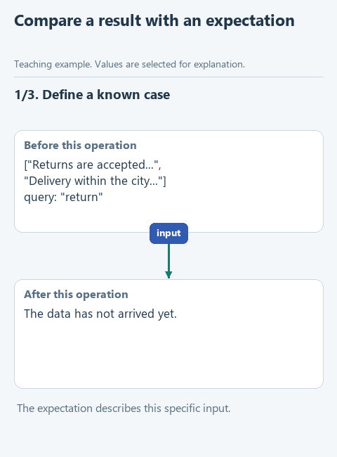

# Optional: let tests repeat the checks

In the [search lesson](01-search.md) the function found two of the three clauses, as expected. But what happens with an empty query? With a duplicate clause? With a query that is nowhere in the policy? Checking all that by hand after every edit gets tedious, and sooner or later a case gets forgotten.

Programmers solve this with unit tests: small checks that call a function with chosen inputs and compare the result with the expected one. You write the condition once and rerun it as often as you like with one click.

For example, a test gives the function two clauses, "Returns are accepted..." and "Delivery within the city...", with the query "return" and expects a list with only the first clause. If the function returns anything else, the test shows what was expected and what came back.

[Static version](../../assets/01-note-search/test-result.png).

## Run the prepared checks

In the `lesson-01-01-search` project open `tests/test_lesson.py`. Right-click the line `class LessonTests` and choose **Run**. PyCharm [can run a single test class](https://www.jetbrains.com/help/pycharm/performing-tests.html); there is no need to run the whole `tests` folder.

The result appears at the bottom. The group has two checks:

- `test_find_notes` checks your function: letter case, spaces in the query, a duplicate clause, no matches, an empty query, and that the original list stays unchanged.
- `test_find_notes_alt` does the same for the one-line version. If you did not write it, the check is marked as skipped, and that is fine: the task is optional.

If a check fails, open its result. It shows the expected value and what the function returned, or the error that occurred. Find the cause in the function and run the checks again. Do not change the expected answer in the test to make it pass: then the test stops checking anything.

## What tests will not show

Tests check exactly the cases written in them. A passing run means the search works on those cases. If tomorrow the policy gets a clause with "return" misspelled, the test will not know: such a case has to be added to it separately.

In the starters of later lessons, `tests/test_lesson.py` checks that lesson's task: reading the file, writing the journal or the whole run. Before running, check which folder is open in Project.

Back to [the search lesson](01-search.md), or on to [read the policy from a file](02-read.md).
