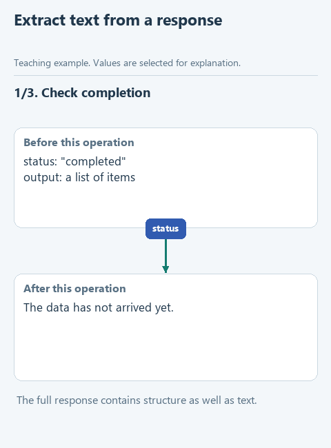

# Extract text from a service response

> **Where we are.** We can build the request for the model. Before sending it, we deal with the other end: what the response looks like and how to get the text for the customer out of it.
> `messages -> model -> [service response -> text]`

A model service does not return a single sentence. It returns a dictionary with service fields: the state of the response, a list of its parts, the type of each part. Print it as is, and the customer sees a data structure. Grab the first field that looks right, and you may miss part of the text or treat a cut-off answer as complete. So we write `extract_answer`, which checks that the response is complete, collects the text parts and returns a plain string.

We work with the prepared file `data/response.json`, which follows the format of a real response. We know what is inside, so we can check our function before connecting a model.

## Open the starter

Download [this lesson's starter](../../downloads/lesson-02-02-response.zip), extract it and open the `lesson-02-02-response` folder in PyCharm. The current task is `extract_answer` in `assistant.py`.

## Look at the data

Open **data -> response.json**. `status` with the value `"completed"` says the response is finished. `output` holds the list of items; text messages are marked `"type": "message"` and each has its own `content` list. The text itself sits in parts of type `"output_text"`, in the `text` field. In our file that text is "You can return an item within 14 days."

This is the course's own normalized format, modelled on the [Responses API](https://developers.openai.com/api/docs/guides/text). Later, `transport.py` converts each service's real response into it, since services do not all return the same structure.

To read a field that may be missing, use `get`:

```python
part = {'type': 'output_text', 'text': 'You can return an item within 14 days.'}
part['text']             # 'You can return an item within 14 days.'
part.get('missing', '')  # '' - the fallback when the key is absent
```



[Static version](../../assets/02-note-assistant/lesson-02-response.png).

## Your turn

The status check and the empty list `parts` are already in `extract_answer`. Replace `raise NotImplementedError(...)` with the code below and fill in the gaps:

```python
    for item in response.get('output', []):
        if item.get('type') == 'message':
            for part in item.get('content', []):
                if part.get('type') == 'output_text':
                    parts.append(...)
    answer = '\n'.join(parts).strip()
    if not answer:
        raise ValueError('The response contains no text')
    return ...
```

1. Append the part's text: `part['text']`.
2. Return the finished string `answer`.

There are two loops, one inside the other. The outer one goes through the items of `output` and picks messages; the inner one goes through a message's parts and picks text. `'\n'.join(parts)` joins the pieces with line breaks, and `strip()` trims the ends. If no text was found at all, the function raises an error instead of returning an empty string that could pass for an answer.

## Run it

Open `demo.py` and choose **Run 'demo'**. The Run window shows:

```text
You can return an item within 14 days.
```

The demonstration read the dictionary from `response.json`, passed it to your function and printed what came back. No model is involved: we extracted text that was already in the file.

## Try to break it

Open `data/response.json` and change `"completed"` to `"incomplete"`. Run `demo.py`: the function stops with "Model response is incomplete". Services set such a status, for example, when an answer was cut off at the length limit. Showing a customer half a sentence is worse than reporting an error. Change it back to `"completed"`.

## What we have now

The program separates the answer text from the service's structure and does not pass a cut-off answer off as complete. To run the prepared checks, open `tests/test_lesson.py` and run `class LessonTests`.

Next: [connect the request and the answer](03-answer.md). Back to [all lessons](../README.md).
