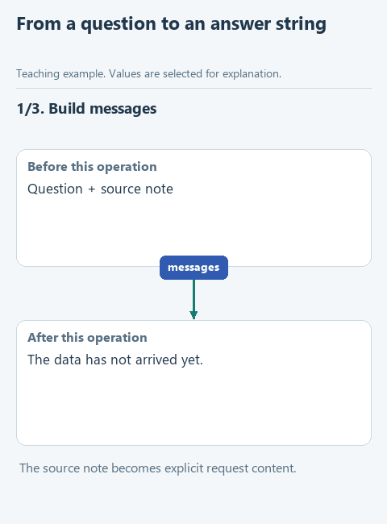

# Connect the request and the answer

> **Where we are.** One function builds the messages, another extracts the text from a response. The link between them is missing: sending the messages and receiving the response. We join everything into one function.
> `question + clauses -> messages -> [sending] -> response -> text`

Messages can be sent in different ways: to a cloud service, to Ollama on your own computer or, for a check, nowhere at all, by reading a prepared response from a file. If one way were hard-coded inside the function, every change of connection would mean rewriting it and risking what already worked. So the way of sending is passed in as a parameter, `send`. Today it reads a prepared response; in the next lesson it will be a real model, and the function itself will not change.

The split also helps when something goes wrong. If the answer is wrong, you can check separately what went into the request, whether it reached the service and whether the response was read correctly.

## Open the starter

Download [this lesson's starter](../../downloads/lesson-02-03-answer.zip), extract it and open the `lesson-02-03-answer` folder in PyCharm. The current task is `answer_question` in `assistant.py`.

## Look at the data

`demo.py` makes this call:

```python
result = answer_question(
    'How many days do I have to return an item?',
    ['Returns are accepted within 14 days.'],
    send_fixture,
)
```

The first two arguments are familiar: the question and the list of policy clauses. The third, `send_fixture`, is a ready function from `transport.py`. It reads `data/response.json` and returns the dictionary from it. Note that `send_fixture` is written without parentheses: we pass the function itself, not the result of calling it. Inside `answer_question` it is available as `send`, and `send(messages)` will call exactly this function.



[Static version](../../assets/02-note-assistant/lesson-03-answer.png).

## Your turn

`answer_question` already checks for an empty list of clauses and builds the messages. Replace `raise NotImplementedError(...)` with three lines and fill in the gaps:

```python
    response = ...
    answer = ...
    return answer
```

1. `response` gets the result of `send(messages)`.
2. `answer` gets the result of `extract_answer(response)`.

If there are no clauses, the function returns "No matching notes." at the very start and does not call the model: there would be nothing to answer from.

## Run it

Open `demo.py` and choose **Run 'demo'**. The Run window shows:

```text
You can return an item within 14 days.
```

Follow the path: `build_messages` assembled the rule, question and clause; `send(messages)` called `send_fixture`, which returned the dictionary from the file; `extract_answer` took the string out of it, and `return` handed it back to `demo.py`, which printed it.

## Try to break it

Change the question in `demo.py` to `'How long does city delivery take?'` and run again. The answer stays the same: there is no model here, and `send_fixture` always returns the same prepared response. That is fine for checking that the functions fit together, and says nothing about how a real model will answer. Put the original question back.

## What we have now

The path from question to answer text is assembled and checked on known data. In the next lesson we pass `send_live` instead of `send_fixture`, and a real model will answer. To run the prepared checks, open `tests/test_lesson.py` and run `class LessonTests`.

Next: [connect a real model](04-connect.md). Back to [all lessons](../README.md).
