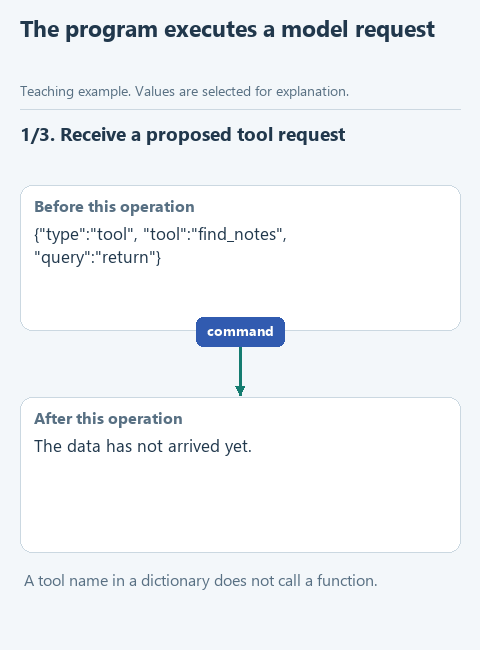

# Execute a permitted tool request

> **Where we are.** Until now we chose the policy clause for the model ourselves. Now the model can ask the program to search the policy. Today is the first half: the program receives the model's request and decides whether to carry it out.
> `task -> model -> [command -> check -> search] -> result`

A customer asks about returns. Instead of answering in text, the model replies with a request: run `find_notes` with the query "return". But it could just as well write `search_notes`, which does not exist in our program, or ask for `delete_file`. A correctly formatted JSON request does not make the action acceptable.

So we put a check between the model's reply and any action. `dispatch_tool` will know exactly two permitted actions: read the policy and search it. It rejects every other name, requires a text query for searching and takes the file path from the program, not from the model. The model can ask, but it cannot add a new capability to the program with one line of text. This is the boundary the introduction promised the administrator: an agent's permissions are set in code, not in the prompt.

## Open the starter

Download [this lesson's starter](../../downloads/lesson-03-01-tools.zip), extract it and open the `lesson-03-01-tools` folder in PyCharm. The current task is `dispatch_tool` in `agent.py`. The model connects through the settings saved in lesson 2.4.

How the model's text becomes a request is handled by the ready `decide_live` in `decisions.py`. If you want to write it yourself, see the optional [prepared-modules workbook](../extra-prepared-modules/README.md).

## Look at the data

For the task "find the return clauses in the policy", `decide_live` turns the model's reply into a dictionary:

```python
command = {'type': 'tool', 'tool': 'find_notes', 'query': 'return'}
command.get('tool')   # 'find_notes'
```

`type` with the value `tool` means the model is asking for an action, `tool` names the action and `query` holds the search text. Our function receives this dictionary, picks the matching function by name and returns its result.

The path to the policy comes in a separate parameter, `notes_path`, and the program sets it. So the model can ask to read or search the policy file, but it cannot point the program at any other file on the computer.

This request format is the course's own small protocol. The big APIs offer native function calling for the same purpose, and the idea is identical: the model describes the action, the program performs it.



[Static version](../../assets/03-tool-agent/lesson-01-tools.png).

## Your turn

Replace `raise NotImplementedError(...)` in `dispatch_tool` with the code below and fill in the gaps:

```python
def dispatch_tool(command: dict, notes_path: Path) -> dict:
    name = command.get('tool')
    if name == 'read_notes':
        return {'notes': ...}
    if name == 'find_notes':
        query = command.get('query')
        if not isinstance(query, str):
            raise ValueError('Search requires a string query')
        notes = read_notes(notes_path)
        return {'matches': ...}
    raise ValueError('Unknown tool: ' + str(name))
```

1. In the `read_notes` branch, call `read_notes(notes_path)`.
2. In the search branch the clauses are already read into `notes`; pass them with `query` to `find_notes`.

We reuse the functions from section 1 instead of writing the search again. The last line catches every name other than the two permitted ones: the program does not try to guess what the model meant. If the dictionary has no `tool` field at all, `command.get('tool')` returns `None` and also ends up at that error. `isinstance(query, str)` stops a number or a list from reaching the search.

## Run it with the model

Open `demo.py` and choose **Run 'demo'**. The model gets the task to find the return clauses, returns a command, and `demo.py` prints it and passes it to your function. We expect `find_notes` with a query about returns and a dictionary with the found clauses.

If the model answered with text or chose another tool, compare its command with the task: the program does not quietly replace the model's decision. Small local models sometimes break the JSON format, and `decide_live` reports it. If that keeps happening, switch models with `configure_model.py`; your function stays the same.

## Check the function on its own

Open `demo_check.py` and choose **Run 'demo_check'**. The command is fixed here, with no model, so the result is always the same:

```text
{'matches': ['Returns are accepted within 14 days.', 'RETURNED money goes back to the original card.', 'A receipt or order number is required for a return.']}
```

To run the prepared checks, open `tests/test_lesson.py` and run `class LessonTests`.

## Try to break it

In `demo_check.py`, find the dictionary passed to `dispatch_tool` and change `'find_notes'` to `'search_notes'`. Run again. We expect `ValueError: Unknown tool: search_notes`, and the file is never read. That is the boundary in code, however confidently a model might propose an invented action. Put `'find_notes'` back.

The check stops forbidden actions; it does not choose the right query for the model. If the model asks for a permitted search for "delivery", the function runs it. Whether that search fits the customer's question is a separate matter, and now you can tell the two cases apart: the program rejected a forbidden action, or it carried out a permitted one the model chose badly.

## What we have now

The model can ask for a search, and the program decides whether to carry it out. Checks and limits like these are called **guardrails**. Ours are plain Python conditions: a permitted name and a text query. The found clauses are still with the program; nobody has passed them to the model yet. That is the next step: [return tool results to the model](02-cycle.md). Back to [all lessons](../README.md).
