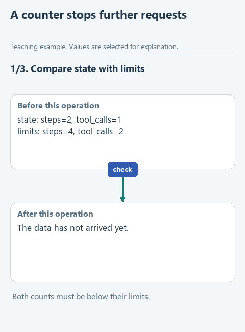

# Limit the number of actions

> **Where we are.** The assistant has an agent loop: the model chooses an action, the program carries it out, the result returns to the model. This section is about controlling that loop, starting with stopping it in time.
> `model -> action -> result -> [limit check] -> model ...`

Imagine the agent has already read the policy but keeps asking to read it again. Each request is permitted, so `dispatch_tool` lets it through. Meanwhile the loop keeps turning, using time and, with a cloud service, money. A manager responsible for the pilot's budget will not be pleased.

A line in the prompt such as "stop when you have the answer" does not solve this: the decision to stop cannot be left to the model alone. So the program counts the model requests and the tool calls itself and stops as soon as either counter reaches its limit. We count actions here; the cost in tokens is a separate topic, covered in the statistics exercise.

## Open the starter

Download [this lesson's starter](../../downloads/lesson-04-01-budget.zip), extract it and open the `lesson-04-01-budget` folder in PyCharm. The current task is `check_budget` in the new file `control.py`.

## Look at the data

Suppose the program has asked the model twice and run one tool. We allow at most four requests and two tool calls. What has been done is in `state`, the limits are in `limits`:

```python
state = {'steps': 2, 'tool_calls': 1}
limits = {'steps': 4, 'tool_calls': 2}
state['steps'] < limits['steps']   # True
```

Both counters are below their limits, so another step is allowed. As soon as either one reaches its limit, the function returns `False` and the program stops the run.



[Static version](../../assets/04-run-control/lesson-01-budget.png).

## Your turn

`check_budget` so far only reads the two counters. Replace `raise NotImplementedError(...)` with the code below and fill in the gaps:

```python
def check_budget(state: dict, limits: dict) -> bool:
    for name in ('steps', 'tool_calls'):
        if type(state.get(name)) is not int or state[name] < 0:
            raise ValueError('Invalid counter: ' + name)
        if type(limits.get(name)) is not int or limits[name] < 1:
            raise ValueError('Invalid limit: ' + name)
    steps_available = ...
    tools_available = ...
    return steps_available and tools_available
```

1. `steps_available` is the comparison `state['steps'] < limits['steps']`.
2. `tools_available` is the same comparison for `'tool_calls'`.

`and` returns `True` only when both comparisons are true. When a counter equals its limit, there is no next step.

The loop at the top checks that the values are whole numbers. `type(value) is int` is stricter than it looks: in Python `True` behaves like the number `1`, and without this check a counter could quietly be a boolean.

The function changes nothing and starts nothing: it only tells the calling code whether it may continue. The counters are increased by the caller, `run_controlled`.

## Run it with the model

Open `demo.py` and choose **Run 'demo'**. The model chooses actions, and your function checks the counters before each step. The limits in `demo.py` are four requests and three tool calls. The Run window shows the commands, their results and either the model's answer or a message that the limit was reached.

## Check the function on its own

Open `demo_check.py` and choose **Run 'demo_check'**. With `steps=2`, `tool_calls=1` and limits of `4` and `2`, we expect `True`. To run the prepared checks, run `class LessonTests` in `tests/test_lesson.py`.

## Try to break it

In `demo.py` change the tool-call limit from `3` to `1` and run again. If the model wants more than one action, the program stops it after the first and reports the limit. The decision is made by the code, not by the model. Change it back to `3`.

## What we have now

The agent can no longer run forever: the number of requests and actions is limited in the program, whatever the model thinks about its task. It is another guardrail, next to the check of permitted tools.

Next: [choose history for the next request](02-context.md). Back to [all lessons](../README.md).
