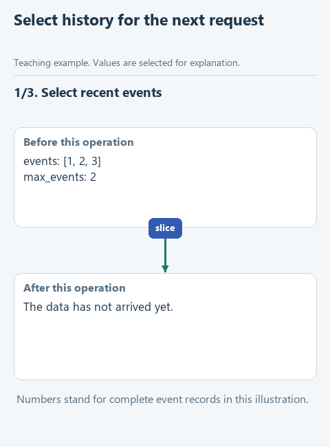

# Choose history for the next request

As the loop continues, its history grows. We may want the next model request to include only recent events while keeping the full record for investigation. The exercise makes those two uses of history explicit.

## Open this starter

Download [this lesson starter](../../downloads/lesson-04-02-context.zip), choose **Extract All**, and open the extracted `lesson-04-02-context` folder with **File -> Open** in PyCharm. In **View -> Tool Windows -> Project**, find `control.py` -> `select_context`. Earlier components are prepared; the current function deliberately pauses with `NotImplementedError`. Keep your previous project in its own folder. The main run uses the connection saved in the [required connection lesson](../../course/02-note-assistant/04-connect.md). The offline `demo_check.py` remains a separate code check.

## Follow the data

Take events with step numbers 1, 2 and 3 and `max_events=2`. The selected context should contain steps 2 and 3 plus the unchanged task. These numbered events are a small illustration of selection; real tool events contain commands and results.



[Static diagram](../../assets/04-run-control/lesson-02-context.png). This illustrates the data flow; it is not a recording of an unfinished starter running.

## Complete the function

Keep the prepared function header. Fill each `...` using the hints below, then remove the `raise NotImplementedError(...)` pause in the starter. The displayed fragment explains the function body; it is not a separate script to paste elsewhere.

```python
def select_context(task: str, events: list[dict], max_events: int) -> dict:
    if type(max_events) is not int or max_events < 0:
        raise ValueError('max_events must be a nonnegative integer')
    context = {'task': task, 'events': []}
    if max_events > 0:
        context['events'] = ...
    return context
```

Validate that `max_events` is a nonnegative integer. Use `events[-max_events:]` when it is positive and `[]` when it is zero. The special zero case matters: `events[-0:]` would select the entire list.

Return `{'task': task, 'events': recent}`. Do not remove items from `events`. A slice creates a new list, though it does not deeply copy each event dictionary. This simple policy limits event count, not tokens, and may omit information the model needs.

## Run and inspect

Open `demo.py` directly under **Project -> lesson-04-02-context**, right-click in its editor and choose **Run 'demo'**. Read the result in **View -> Tool Windows -> Run**. A `Complete ...` message means the exercise pause is still present.

Run `demo.py` and compare the printed selected context with the full saved events. Try the offline cases for zero and for a limit larger than the history length.

Choosing what to send is part of context engineering. A long context window does not mean every important fact is automatically included or reliably used; our program still selects and arranges the input.

After a successful demonstration, optionally open the relevant file under `tests`, right-click its test class and run it. Those checks repeat defined expectations; they do not certify every possible input or every model answer.

[All lessons](../../course/README.md).
