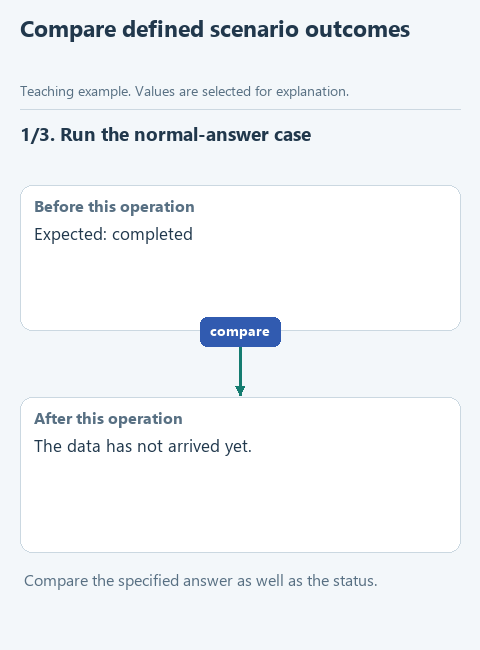

# Compare behavior across scenarios

One attractive answer is a poor acceptance test. We will run a set of cases and compare the outcomes with expectations defined before the run. A case that should stop at a limit can pass even though it produces no final answer.

## Open this starter

Download [this lesson starter](../../downloads/lesson-04-04-evaluation.zip), choose **Extract All**, and open the extracted `lesson-04-04-evaluation` folder with **File -> Open** in PyCharm. In **View -> Tool Windows -> Project**, find `control.py` -> `evaluate_cases`. Earlier components are prepared; the current function deliberately pauses with `NotImplementedError`. Keep your previous project in its own folder. The main run uses the connection saved in the [required connection lesson](../../course/02-note-assistant/04-connect.md). The offline `demo_check.py` remains a separate code check.

## Follow the data

Each case has a name, task, expected status and expected answer. The supplied offline example includes a normal answer and repetition until the budget stops execution. Another test deliberately expects an answer different from the returned one, so the summary should include a failed case.



[Static diagram](../../assets/04-run-control/lesson-04-evaluation.png). This illustrates the data flow; it is not a recording of an unfinished starter running.

## Complete the function

Keep the prepared function header. Fill each `...` using the hints below, then remove the `raise NotImplementedError(...)` pause in the starter. The displayed fragment explains the function body; it is not a separate script to paste elsewhere.

```python
def evaluate_cases(cases: list[dict], run) -> dict:
    results = []
    for case in cases:
        actual = run(case['task'])
        passed = ...
        results.append({'name': case['name'], 'passed': passed})
    passed_count = sum(item['passed'] for item in results)
    return {'passed': passed_count, 'total': len(results), 'results': results}
```

For each case, call `run(case['task'])`. Set `passed` only when both the returned status and answer match the corresponding expectations. Append `{'name': case['name'], 'passed': passed}` to the results list.

Return `passed`, `total` and `results`: count true case outcomes, count all cases and preserve the per-case details. For an empty input list return zero counts and an empty results list. Do not replace a failed comparison with a successful status just because the function ran.

## Run and inspect

Open `demo.py` directly under **Project -> lesson-04-04-evaluation**, right-click in its editor and choose **Run 'demo'**. Read the result in **View -> Tool Windows -> Run**. A `Complete ...` message means the exercise pause is still present.

Use `demo_check.py` to check deterministic expectations, then inspect a live run separately. Exact-answer comparisons are deliberately strict and may be unsuitable for differently worded but correct generated text. Practical evals need criteria that match their intended use; this exercise establishes the habit of defining and recording those criteria.

After a successful demonstration, optionally open the relevant file under `tests`, right-click its test class and run it. Those checks repeat defined expectations; they do not certify every possible input or every model answer.

[All lessons](../../course/README.md).
