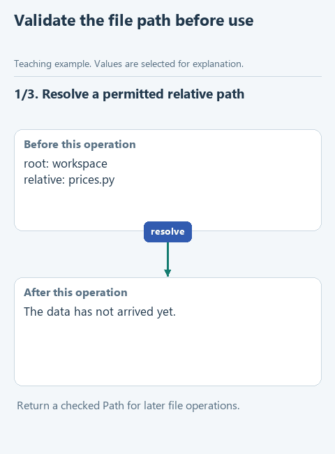

# Restrict the working folder

> **Where we are.** The assistant can search, answer and work in a controlled loop. In the last section it starts changing code - this is how Claude Code, Cursor and other coding agents work. First, we limit which files it may touch at all.
> `model's proposal -> [path check] -> read -> change -> check`

The exercise has a small module, `prices.py`, that calculates the total price of an order, and it has a bug. We will ask the model to propose a fix. But before the program reads or changes a file because a model asked, it has to decide which files are allowed. The model may name `prices.py`, or `../outside.py`, a file outside the working folder, or a system file anywhere on the disk.

This is the question an administrator asks before letting an agent near a server: what exactly can it reach? The answer belongs in code. `workspace_path` takes a file name, works out its full path and checks that it lies inside the exercise folder `workspace` and ends in `.py`. Every other function in this section gets file paths only through it.

## Open the starter

Download [this lesson's starter](../../downloads/lesson-05-01-paths.zip), extract it and open the `lesson-05-01-paths` folder in PyCharm. The current task is `workspace_path` in `workspace.py`. The `workspace` folder holds the exercise `prices.py` and its tests.

## Look at the data

`prices.py` contains one function:

```python
def total_price(price, quantity):
    return price + quantity
```

The total should be price times quantity, but the code adds them. The agent will fix that in the next lessons.

The path is built like this:

```python
root = ROOT / 'workspace'
relative = 'prices.py'
candidate = (root / relative).resolve()
```

The `/` operator on a `Path` joins a folder and a file name, and `resolve()` works out the full path, expanding `..` and links. The full path is what we check: the text `'workspace/../secret.py'` starts with the right folder name but leads outside it.



[Static version](../../assets/05-coding-harness/lesson-01-paths.png).

## Your turn

The full path is already computed in `workspace_path`. Replace `raise NotImplementedError(...)` with the code below and fill in the gap:

```python
    if Path(relative).is_absolute() or not candidate.is_relative_to(root):
        raise ValueError('The path must stay inside the exercise folder')
    if ...:
        raise ValueError('This exercise only handles Python files')
    return candidate
```

In the gap, compare the extension: `candidate.suffix != '.py'`. `suffix` returns the end of the name with its dot, such as `'.py'`, and `!=` means "not equal".

The first check is ready: `is_absolute()` rejects an absolute path such as `C:\Windows\...`, and `is_relative_to(root)` checks that the full path lies inside the working folder. If both checks pass, the function returns the checked path. It does not open the file: reading or writing is done by the calling code, and only at this address.

## Run it with the model

Open `demo.py` and choose **Run 'demo'**. The program calls your function, reads the permitted `workspace/prices.py` and asks the model to propose a fix. The Run window shows the path and the proposed code. Nothing is written yet.

## Check the function on its own

Open `demo_check.py` and choose **Run 'demo_check'**. We expect:

```text
workspace/prices.py
```

To run the prepared checks, run `class LessonTests` in `tests/test_lesson.py`.

## Try to break it

In `demo_check.py`, replace `'prices.py'` with `'../notes.py'` and run. We expect the error "The path must stay inside the exercise folder". Then try `'tests/README.md'`: the file is inside the folder but is not Python, so the error is different. Put `'prices.py'` back.

## What we have now

The file boundary has moved from a wish in the model's instructions into the program's code. If the agent asks for a file outside the folder, the program refuses, however confidently it asks.

This boundary has a limit an administrator should know about. The function controls which files our program opens. If an agent is allowed to run code, that code can reach any file the user can, and running untrusted code safely requires a separate sandbox, which this course does not build.

Next: [preview a proposed change](02-diff.md). Back to [all lessons](../README.md).
