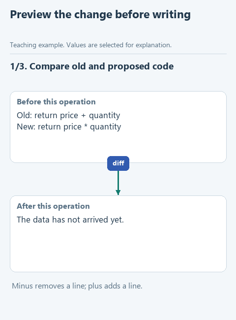

# Preview a proposed change

> **Where we are.** The agent can reach only the files in its working folder. Now it proposes a fix for `prices.py`, and before anything is written, the program shows a person exactly what would change.
> `model's proposal -> [diff for a person] -> approval -> write -> check`

In `prices.py` the order total adds price and quantity instead of multiplying them. The model will propose a fix. Even for a change this small, it is worth seeing it before it is written: a model may also rename the function, delete a check or "improve" something nobody asked about.

`preview_change` prepares the proposal: it compares the old and new text, collects the changed lines and remembers a fingerprint of the original file. The file itself stays as it is. A person sees the concrete change and can accept or reject it, and in the next lesson the fingerprint confirms that the approval applies to the version of the file that person actually saw.

## Open the starter

Download [this lesson's starter](../../downloads/lesson-05-02-diff.zip), extract it and open the `lesson-05-02-diff` folder in PyCharm. The current task is `preview_change` in `workspace.py`.

## Look at the data

The old and new calculation lines:

```python
old_text = '    return price + quantity\n'
new_text = '    return price * quantity\n'
```

Programmers show such changes as a diff: a removed line starts with `-`, an added one with `+`. Every code review on GitHub or GitLab looks like this. For our change the diff is:

```text
--- before/prices.py
+++ after/prices.py
@@ -1,2 +1,2 @@
 def total_price(price, quantity):
-    return price + quantity
+    return price * quantity
```

Together with the diff we keep a hash of the original file: a check value computed from its contents. Change a single character in the file and the hash is different.



[Static version](../../assets/05-coding-harness/lesson-02-diff.png).

## Your turn

In `preview_change` the path is already checked with `workspace_path` and the old text is read. Replace `raise NotImplementedError(...)` with the code below and fill in the gaps:

```python
    lines = difflib.unified_diff(
        old_text.splitlines(keepends=True),
        new_text.splitlines(keepends=True),
        fromfile='before/' + relative,
        tofile='after/' + relative,
    )
    before_hash = hashlib.sha256(path.read_bytes()).hexdigest()
    return {
        'path': relative,
        'before_hash': before_hash,
        'new_text': ...,
        'diff': ...,
    }
```

1. `'new_text'` gets the parameter `new_text`.
2. `'diff'` gets `''.join(lines)`: the library produces the diff line by line, and we want one text. The separator is empty because `keepends=True` already kept the line breaks.

The comparison itself comes from the standard library `difflib`; there is no need to invent it. `fromfile` and `tofile` are only labels in the diff and create no files. `hashlib.sha256(...).hexdigest()` computes the hash from the bytes of the original file.

The function returns a prepared proposal: text to show a person in `diff`, the future code in `new_text` and `before_hash` for the check before writing. Nothing is written to disk.

## Run it with the model

Open `demo.py` and choose **Run 'demo'**. The model receives the exercise `prices.py` and proposes a fix, and your function shows the difference in the Run window. We expect multiplication instead of addition. Read the actual diff carefully: the model may propose extra changes or not fix the bug at all.

## Check the function on its own

Open `demo_check.py` and choose **Run 'demo_check'**. We expect the diff above, with a `-` line for addition and a `+` line for multiplication. Open `workspace/prices.py` afterwards: it still has the old line. To run the prepared checks, run `class LessonTests`.

## What we have now

The agent's proposal is separate from the change to the project: a person sees the exact edit before it reaches the file. For a manager this is one of the main control points: the agent proposes, a person decides.

Next: [apply an approved proposal](03-apply.md). Back to [all lessons](../README.md).
