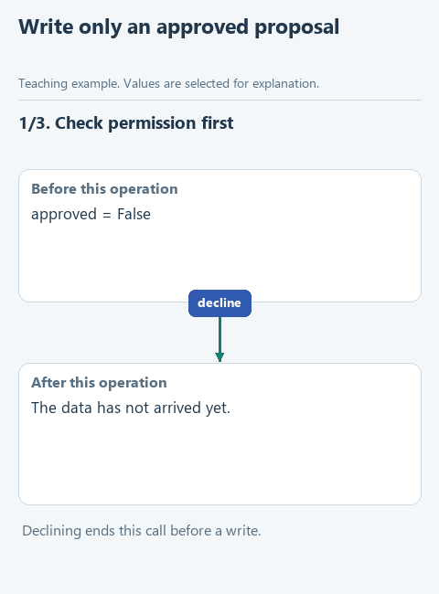

# Apply an approved proposal

> **Where we are.** The agent proposed a change, and the program showed it to a person as a diff. Now we write the change to the file, but only with that person's approval.
> `proposal -> diff -> [approval -> hash check -> write] -> tests`

Showing a change is not the same as being allowed to write it. There is a second trap too: while the person was reading the diff, the file may have changed, for instance a colleague edited it by hand. The proposal then applies to another version of the code, and writing it would wipe out someone else's work.

So `apply_change` writes the file under two conditions: the person approved, and the file still matches the version the proposal was prepared for. If the person declines, the file stays as it is; if the hash does not match, the program stops with an error. Approval becomes part of how the program runs, not just a phrase in a chat with the model.

## Open the starter

Download [this lesson's starter](../../downloads/lesson-05-03-apply.zip), extract it and open the `lesson-05-03-apply` folder in PyCharm. The current task is `apply_change` in `workspace.py`.

## Look at the data

`demo.py` shows the diff and asks in the Run window whether to apply the change. The answer becomes `approved`: `True` if you type `yes` and `False` for anything else. The proposal from the previous lesson arrives in the dictionary `proposal` with the fields `path`, `before_hash`, `new_text` and `diff`.

With `approved=False` the function returns `False` at once and does not touch the file. With approval, it computes the file's hash now, compares it with `proposal['before_hash']` and writes `new_text` only if they match.



[Static version](../../assets/05-coding-harness/lesson-03-apply.png).

## Your turn

`apply_change` already has the line with the checked path. Add the early return for a declined change before it, and replace `raise NotImplementedError(...)` with the hash check and the write. The whole function looks like this; fill in the gap:

```python
def apply_change(root: Path, proposal: dict, approved: bool) -> bool:
    if not approved:
        return False
    path = workspace_path(root, proposal['path'])
    current_hash = hashlib.sha256(path.read_bytes()).hexdigest()
    if current_hash != proposal['before_hash']:
        raise ValueError('The file changed after the proposal was prepared')
    path.write_text(..., encoding='utf-8')
    return True
```

Pass `proposal['new_text']` to `write_text`: the new text the person saw in the diff. The `diff` itself will not do, since it contains service lines with `+`, `-` and `@@`, and the file needs ordinary code. `write_text` replaces the whole file, which is why approval and the hash check come first.

The function returns `True` if the change was written and `False` if the person declined. That value tells the calling code what happened to the file. It does not say the new code is correct: that is for the tests in the next lesson.

## Run it with the model

Open `demo.py` and choose **Run 'demo'**. The program gets the model's proposal and shows the diff, and a question about applying it appears in the Run window. The first time, just press Enter: the change should be declined. Then run again, read the diff carefully and, if you agree with the change, click after the question, type `yes` and press Enter.

## Check the function on its own

Open `demo_check.py` and choose **Run 'demo_check'**. It shows the diff and then `False`: in the offline check there is no approval and the file does not change. To run the prepared checks, run `class LessonTests`.

## Try to break it

Run `demo.py` and wait for the question, but do not answer yet. Open `workspace/prices.py`, add an empty line at the end and save. Now go back to the Run window and type `yes`. The program stops with "The file changed after the proposal was prepared": the file's hash no longer matches the one taken when the diff was shown. Remove the extra line.

## What we have now

The agent's change reaches the file only with a person's approval and only in the version that person saw. A person taking part in the agent's work at such a point is called **human in the loop**. Here the person does not review the result afterwards but decides while the program runs, and a refusal really stops the write. That is how you set which actions an agent takes on its own and which need a human decision.

Next: [check the changed project](04-verify.md). Back to [all lessons](../README.md).
