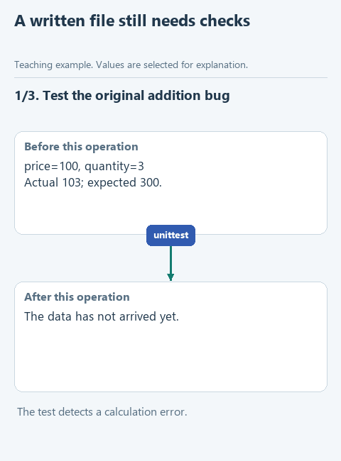

# Check the changed project

An applied file may still contain the wrong calculation. We will run the supplied project tests and return their exit code and output, making a successful write and a verified result separate outcomes.

## Open this starter

Download [this lesson starter](../../downloads/lesson-05-04-verify.zip), choose **Extract All**, and open the extracted `lesson-05-04-verify` folder with **File -> Open** in PyCharm. In **View -> Tool Windows -> Project**, find `workspace.py` -> `check_project`. Earlier components are prepared; the current function deliberately pauses with `NotImplementedError`. Keep your previous project in its own folder. The main run uses the connection saved in the [required connection lesson](../../course/02-note-assistant/04-connect.md). The offline `demo_check.py` remains a separate code check.

## Follow the data

The prepared command uses the current `sys.executable` with `-B -m unittest discover -s tests`. `subprocess.run` returns an object with `returncode`, `stdout` and `stderr`. Exit code zero indicates that this test process completed successfully.



[Static diagram](../../assets/05-coding-harness/lesson-04-verify.png). This illustrates the data flow; it is not a recording of an unfinished starter running.

## Complete the function

Keep the prepared function header. Fill each `...` using the hints below, then remove the `raise NotImplementedError(...)` pause in the starter. The displayed fragment explains the function body; it is not a separate script to paste elsewhere.

```python
def check_project(root: Path) -> dict:
    command = [sys.executable, '-B', '-m', 'unittest', 'discover', '-s', 'tests']
    process = subprocess.run(
        command,
        cwd=root,
        capture_output=True,
        text=True,
        encoding='utf-8',
        errors='replace',
        timeout=5,
    )
    return {
        'passed': ...,
        'returncode': process.returncode,
        'output': ...,
    }
```

Run the prepared argument list with `cwd=root`, `capture_output=True`, `text=True`, `encoding='utf-8'` and a bounded timeout as shown. Return `passed` as `process.returncode == 0`, the actual `returncode`, and `output` as `process.stdout + process.stderr`.

Tests may write to either output stream. Do not report success for every completed process, and do not make the checker silently edit the code it is supposed to inspect.

## Run and inspect

Open `demo.py` directly under **Project -> lesson-05-04-verify**, right-click in its editor and choose **Run 'demo'**. Read the result in **View -> Tool Windows -> Run**. A `Complete ...` message means the exercise pause is still present.

The supplied addition bug should fail. After the correct multiplication change is approved and written, the tests should pass. A real model may propose another result, so inspect the diff and test report rather than assuming success.

The main example now performs one pass: read, request a proposal, show a diff, ask approval, apply and check. It does not implement autonomous repair retries or process isolation. Read the [course conclusion](../conclusion.md) for applications beyond this exercise.

After a successful demonstration, optionally open the relevant file under `tests`, right-click its test class and run it. Those checks repeat defined expectations; they do not certify every possible input or every model answer.

[All lessons](../../course/README.md).
