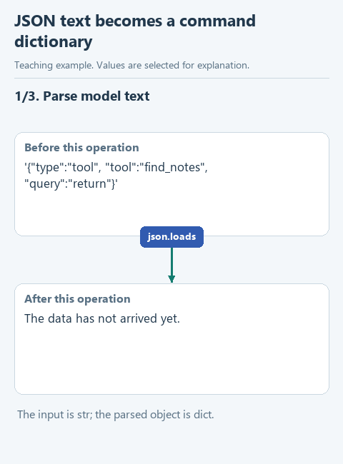

# Parse a command from model text

A model response can contain text that resembles a tool request. Before dispatching it, the program needs an actual dictionary with fields it can inspect. We will also distinguish valid JSON from the particular JSON object our protocol expects.

## Open this starter

Download [this lesson starter](../../downloads/lesson-extra-02-command.zip), choose **Extract All**, and open the extracted `lesson-extra-02-command` folder with **File -> Open** in PyCharm. In **View -> Tool Windows -> Project**, find `decisions.py` -> `parse_decision`. Earlier components are prepared; the current function deliberately pauses with `NotImplementedError`. Keep your previous project in its own folder.

## Follow the data

`text = '{"type":"tool","tool":"find_notes","query":"python"}'` is a Python string. `json.loads(text)` produces a dictionary. Now `command['tool']` accesses the value `'find_notes'`. A JSON array such as `'[]'` parses successfully too, but is not an acceptable command object.



[Static diagram](../../assets/extra-prepared-modules/command-flow.png). This illustrates the data flow; it is not a recording of an unfinished starter running.

## Complete the function

Keep the prepared function header. Fill each `...` using the hints below, then remove the `raise NotImplementedError(...)` pause in the starter. The displayed fragment explains the function body; it is not a separate script to paste elsewhere.

```python
def parse_decision(text: str) -> dict:
    try:
        command = ...
    except json.JSONDecodeError:
        raise ValueError('The model returned text instead of a JSON command: ' + text[:400]) from None
    if not isinstance(command, ...):
        raise ValueError('The command must be a JSON object')
    return command
```

Inside the prepared `try`, assign `command = json.loads(text)`. Keep the supplied `JSONDecodeError` handling, then use `isinstance(command, dict)` for the object check and return `command`.

Returning the original text instead would leave the caller with a string. It could not read fields by name using dictionary indexing. Parsing the command does not authorize its tool name; `dispatch_tool` still owns that separate check.

## Run and inspect

Open `demo_check.py` directly under **Project -> lesson-extra-02-command**, right-click in its editor and choose **Run 'demo_check'**. Read the result in **View -> Tool Windows -> Run**. A `Complete ...` message means the exercise pause is still present.

Run `demo_check.py`. Observe `str` before parsing and `dict` afterward, then the extracted tool and query values. The prepared invalid-text and array examples should fail. As a temporary experiment on a copy, return `text` and inspect why the caller's field access fails; restore the dictionary return afterward.

After a successful demonstration, optionally open the relevant file under `tests`, right-click its test class and run it. Those checks repeat defined expectations; they do not certify every possible input or every model answer.

[All lessons](../../course/README.md).
