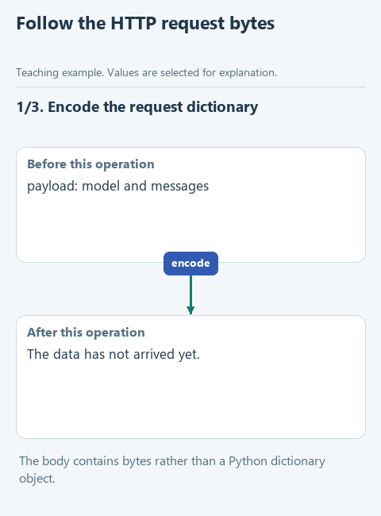

# Send an HTTP request from Python

> **Where we are.** Third lesson of the optional workbook. We can build the messages and parse the reply. In between is the request to the model service itself.
> `messages -> [HTTP request -> response] -> text -> command`

Our program talks to Ollama and to cloud services over HTTP. With Ollama the exchange stays inside your computer; with a cloud service it goes over the internet. The ready `send_live` in `transport.py` chooses the address, assembles a dictionary with the model name and messages, and hands the sending to `request_json`. We write the network part of that function.

This helps tell two kinds of trouble apart: the request never reached the service, or a response came back but not in the shape the program expects. We check the code on known data without a network first, then through the saved connection.

## Open the starter

Download [this lesson's starter](../../downloads/lesson-extra-03-request.zip), extract it and open the `lesson-extra-03-request` folder in PyCharm. In `transport.py`, `request_json` is paused. The headers and the error handlers are already in the function; we fill in the part between them. A real request needs the connection from [lesson 2.4](../02-note-assistant/04-connect.md).

## Look at the data

To check the exchange without a model, `demo_check.py` uses a placeholder address and an empty list of messages:

```python
url = 'https://example.invalid/chat'
payload = {'model': 'exercise-model', 'messages': [], 'stream': False}
```

`model` names the model, `messages` holds the messages and `stream=False` asks for the whole response at once. The real connection is replaced in `demo_check.py` by a test function that accepts the request and returns the bytes `b'{"ok": true}'`; our function must turn them into the dictionary `{'ok': True}`.

`url` is the address, `payload` the request data and the optional `api_key` is for cloud services. The headers are ready: `'Content-Type': 'application/json'` states the format, and a non-empty key adds `Authorization`. We never print the key or the whole request.



[Static version](../../assets/extra-prepared-modules/request-flow.png).

## Your turn

The code goes in two places. First, replace the `raise NotImplementedError(...)` line with:

```python
request = Request(url, data=..., headers=headers, method='POST')
```

Then replace `pass` inside the existing `try` block, one indentation level deeper than `try`, with:

```python
with urlopen(request, timeout=180) as response:
    return json.loads(...)
```

1. `data=` gets `json.dumps(payload, ensure_ascii=False).encode('utf-8')`: the dictionary becomes a JSON string, and `encode` turns it into bytes to send.
2. `json.loads` gets `response.read().decode('utf-8')`: `read()` takes the bytes of the response and `decode` turns them into text, which `json.loads` parses back into a dictionary.

`Request` only describes the request; `urlopen` sends it, and `with` closes the connection afterwards. `timeout=180` is how many seconds a single network operation may take. Leave the `except` branches as they are: they turn an HTTP error or a lost connection into a clear message, for example HTTP 401 into a hint to check the API key.

## Run it

Open `demo_check.py` and choose **Run**. The Run window shows `POST`, the address `https://example.invalid/chat`, the request data and the result `{'ok': True}`. To run the prepared checks, run `tests/test_lesson.py`.

Then run `demo.py`. It makes a real request through the saved connection: it asks "How many days do I have to return an item?" and passes the clause "Returns are accepted within 14 days." Here the model simply answers from the note, with no tools: that is enough to check the network function. We expect an answer about lists keeping their order; the exact words depend on the model. A cloud service counts this request against your quota.

## How different services end up in one format

Look at the ready `send_live` in the same `transport.py`. It calls your `request_json`, but the dictionary it gets back differs by service: Ollama keeps the text in `response['message']['content']`, cloud services in the first item of `choices`. Having checked that the response is complete, `send_live` passes the text to `course_response`, which wraps it in the course format with `status` and `output`. `extract_answer` reads that format whichever service was used. For the full walk through every branch, see [how send_live works](../02-note-assistant/extra-send-live.md). Python's documentation covers [urllib.request](https://docs.python.org/3.14/library/urllib.request.html) and [json](https://docs.python.org/3.14/library/json.html).

Next: [assemble decide_live](04-decision.md) from building messages, sending and parsing. Back to [the workbook](README.md).
