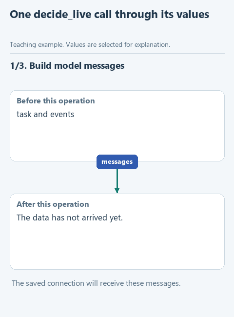

# Assemble decide_live

We can prepare a task message, send a request and parse command text. Now connect those pieces to reproduce the ready-made decision function used by our note assistant. This closes the explanation of how a Python task becomes the model's requested next action.

## Open this starter

Download [this lesson starter](../../downloads/lesson-extra-04-decision.zip), choose **Extract All**, and open the extracted `lesson-extra-04-decision` folder with **File -> Open** in PyCharm. In **View -> Tool Windows -> Project**, find `decisions.py` -> `decide_live`. Earlier components are prepared; the current function deliberately pauses with `NotImplementedError`. Keep your previous project in its own folder.

## Follow the data

The input remains `task` plus `events`. `build_decision_messages` returns messages; `send_live` returns a normalized response; `extract_answer` returns JSON text; `parse_decision` returns a command dictionary. These intermediate values have different types and purposes.



[Static diagram](../../assets/extra-prepared-modules/decision-flow.png). This illustrates the data flow; it is not a recording of an unfinished starter running.

## Complete the function

Keep the prepared function header. Fill each `...` using the hints below, then remove the `raise NotImplementedError(...)` pause in the starter. The displayed fragment explains the function body; it is not a separate script to paste elsewhere.

```python
def decide_live(task: str, events: list[dict]) -> dict:
    messages = ...
    response = ...
    text = ...
    return ...
```

Call the functions in that order. Pass the message list to `send_live`, its response to `extract_answer`, and that text to `parse_decision`. Return the parsed dictionary without executing it here.

Keep failures visible. If the service returns an incomplete response or the model produces prose instead of JSON, the corresponding function should reject it. Do not silently replace an invalid decision with a convenient prepared command.

## Run and inspect

Open `demo_check.py` directly under **Project -> lesson-extra-04-decision**, right-click in its editor and choose **Run 'demo_check'**. Read the result in **View -> Tool Windows -> Run**. A `Complete ...` message means the exercise pause is still present.

Run `demo_check.py`, which substitutes the sending operation and checks the complete chain offline. Then run `demo.py` for an actual decision using your connection. Confirm the returned dictionary before passing it to `dispatch_tool`. The agent loop remains the caller coordinating decisions, execution, history and termination.

After a successful demonstration, optionally open the relevant file under `tests`, right-click its test class and run it. Those checks repeat defined expectations; they do not certify every possible input or every model answer.

[All lessons](../../course/README.md).
