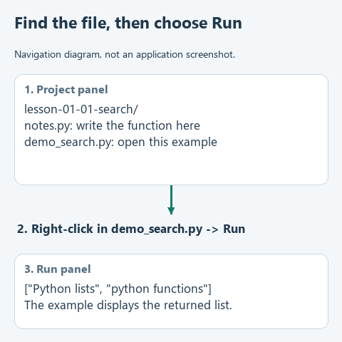

# Find a file and run the right example in PyCharm

A lesson archive contains a project folder, not a single script. Extract it first using the file manager's **Extract All** action. In PyCharm choose **File -> Open**, select that extracted folder and open it as a project. Open the folder named in the lesson, such as `lesson-01-01-search`, rather than the parent containing every course project.

## Find the exercise

Open **View -> Tool Windows -> Project**. Expand the project root using its small arrow. Python modules such as `notes.py` appear directly under that root; `data` holds source files and `tests` holds optional checks. Double-click the module named by the lesson and find the target function. Earlier functions may already be complete; the current one contains a deliberate `NotImplementedError` pause.

Write the function body using the lesson hints, then remove its pause. Do not add a second copy of the function header. Use four spaces per indentation level and keep the final return outside a loop when the lesson calls for collecting all results.

## Run a particular file

Open the demonstration file named by the lesson. Right-click inside its editor and choose **Run 'demo'**, or the corresponding script name. This creates a run configuration for that file. We do not need an unspecified "run the project" button.

The output appears in **View -> Tool Windows -> Run**. Read both normal output and error messages. A message beginning `Complete ...` is the prepared exercise pause; it tells you that the current function still needs work. A traceback is a call path to an error, not evidence that PyCharm failed to open the project.

If no interpreter is selected, use the project's Python interpreter setting to select your installed Python or create a project virtual environment. The core lessons use the standard library. A virtual environment keeps optional dependencies local to that project.

This is a navigation diagram, not a recording of PyCharm.

## Which demonstration should I choose?

Early lessons run entirely offline. After the required connection lesson, the main `demo.py` uses the saved model connection. `demo_check.py`, where supplied, uses known inputs or prepared responses to check your code independently of model behavior. These runs answer different questions; neither should be silently substituted for the other.
